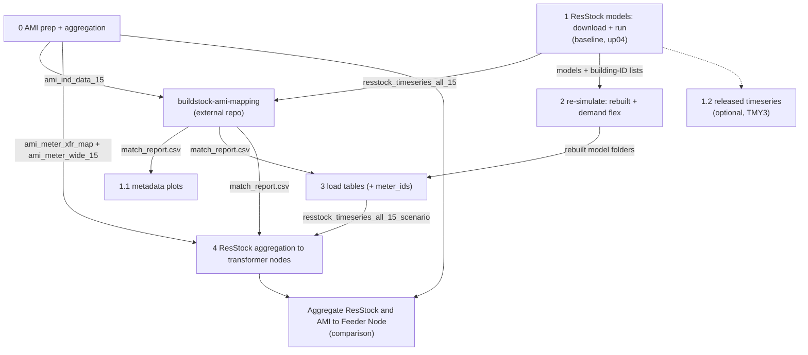

# GrRIDS: ResStock + AMI Load Analysis

Data pipeline for the GRIDs project. It runs NLR/NREL ResStock building models for upstate New York, prepares AMI (smart meter) interval data, matches simulated buildings to metered service points, aggregates both to distribution feeder nodes, and compares ResStock against measured AMI loads.

**Weather basis:** the project uses the **AMY** ResStock release for both metadata and models. See [docs/weather_basis_amy_vs_tmy.md](docs/weather_basis_amy_vs_tmy.md).

**Methodology:** the full technical description (methods, justification, conventions, limitations) is in [docs/pipeline_summary.md](docs/pipeline_summary.md).

---

# Contents

1. [Environment setup](#environment-setup)
2. [Project context](#project-context)
3. [Quick start: run order](#quick-start-run-order)
4. [Notebook guide](#notebook-guide)
5. [Key facts and caveats](#key-facts-and-caveats)
6. [Files: inputs and outputs](#files-inputs-and-outputs)
7. [Related repositories](#related-repositories)

---

# Environment setup

Python 3.13 with the pinned packages in [requirements.txt](requirements.txt).

### Windows (PowerShell)

```powershell
py -3.13 -m venv .venv
.\.venv\Scripts\Activate.ps1
python -m pip install --upgrade pip
python -m pip install -r requirements.txt
```

### macOS/Linux

```bash
python3.13 -m venv .venv
source .venv/bin/activate
python -m pip install --upgrade pip
python -m pip install -r requirements.txt
```

### Validate

```bash
python -c "import pandas, numpy, matplotlib, pyarrow, fastparquet, boto3, openpyxl; print('python deps OK')"
python -m awscli --version
```

### External tools (not pip-managed)

- OpenStudio (with its bundled EnergyPlus). Notebook 1 is set to `C:/openstudio-3.8.0/bin/openstudio.exe`; edit `openstudio_path` in section 3 if yours is elsewhere (e.g. macOS: `/Applications/OpenStudio-<version>/bin/openstudio`).
- Internet access to the public S3 bucket `oedi-data-lake` (no AWS account needed; downloads are anonymous).

### Running the notebooks

Open the notebooks from `grid_edge_fy25/notebooks/` and run them **top to bottom**. All paths are relative to that folder. Each notebook starts with a preflight cell that checks the required packages.

The `data/` and `results/` folders are git-ignored: they are created or filled by running the notebooks and are not in the repository.

---

# Project context

The goal is feeder-level load profiles for the Dryden, NY distribution circuit, built by combining:

- **ResStock**: NLR's residential building stock models, simulated here to get 15-minute electricity profiles for representative buildings.
- **AMI**: 15-minute smart meter data for about 792 service points on the circuit.
- **OpenDSS feeder model**: transformer-level topology used to map meters and buildings to feeder nodes.

The matched, aggregated profiles feed downstream optimization work on demand flexibility and grid edge resources.

---

# Quick start: run order

Run the notebooks in numeric order: **0 → 1 → (external mapping) → 1.1 → 2 → 3 → 4**. Notebook 0 and notebook 1 do not depend on each other and can run in either order. Notebook 1.2 is optional.



| Step | Notebook / tool | Needs | What you get |
|---|---|---|---|
| 0 | `0_ami_data_prep_and_aggregation.ipynb` | raw AMI file, `location_reference.csv` | Cleaned 2024 AMI tables; AMI aggregated per transformer node; meter-to-transformer map and meter-wide AMI table |
| 1 | `1_resstock_models_download_and_run.ipynb` | NY metadata CSV, OpenStudio | Downloaded and simulated ResStock buildings (baseline and upgrade 4), original load tables |
| ext | `buildstock-ami-mapping` (external) | outputs of 0 and 1 | `results/match_report.csv` (AMI meter to ResStock building) |
| 1.1 | `1.1_resstock_metadata_plots.ipynb` | `match_report.csv`, metadata CSV | Distribution plots of matched buildings |
| 1.2 | `1.2_resstock_timeseries_download.ipynb` (optional) | building-ID list from 1 | NREL-released TMY3 timeseries (not used downstream) |
| 2 | `2_resstock_models_df_run.ipynb` | models and building-ID lists from 1 | Rebuilt models (2025_Release_1 measures) and demand-flex models, simulated |
| 3 | `3_resstock_load_table_build.ipynb` | rebuilt models from 2, `match_report.csv` | Load tables per scenario with a `meter_ids` column; `building_to_meter_map.csv` |
| 4 | `4_resstock_aggregation.ipynb` | load tables from 3, `match_report.csv`, AMI map and meter-wide table from 0 | ResStock residential load per transformer node for each scenario, with AMI fallback for unmatched meters |
| - | `Aggregate ResStock and AMI to Feeder Node_02022026-Copy1.ipynb` | aggregated node files from 0 and 4 | Branch-level ResStock vs AMI comparison plots |

## Scenarios analysed

All scenarios use the same 766 buildings (7 counties), the `Ithaca_2024.epw` weather file and 35,040 15-minute timestamps. Upgrade 4 only applies to part of the buildings (`applicability == True`); the rest are filled according to `MISSING_BLDG_POLICY` in notebook 4.

| Scenario | Made by | Description | Used for |
|---|---|---|---|
| AMI (measured) | notebook 0 | Smart meter data of ~792 service points, gaps handled by `GAP_METHOD` (`zero`, `nan`, `interpolate`) | Reference; matching; fallback for unmatched meters |
| Original baseline (`UPGRADE = 0`) | notebook 1 | Released baseline models, simulated with 2024 weather | Matching against AMI and validation |
| Original upgrade 4 (`UPGRADE = 4`) | notebook 1 | ENERGY STAR heat pump with the existing system as backup | Matching/validation of the upgrade set |
| `baseline_rebuilt` | notebooks 2 and 3 | Baseline rebuilt with the 2025_Release_1 measures, no flexibility | Baseline for the scenario comparison |
| `up04_rebuilt` | notebooks 2 and 3 | Heat pump (upgrade 4) rebuilt, no flexibility | Control for the demand-flex run |
| `up04_df_2F` | notebooks 2 and 3 | Heat pump plus upgrade 24: HVAC demand flexibility, 2 F load shed during on-peak hours | Demand-flex scenario |

Compare scenarios only among the three rebuilt runs. The original runs are kept for validation against AMI, because the rebuild shifts annual electricity by a few percent.

## Inputs and outputs per step

Paths are under `grid_edge_fy25/`. `<s>` is a scenario name, `<g>` the AMI gap tag.

| Step | Inputs | Outputs |
|---|---|---|
| 0 | `data/input_files/consumption/ch1_4301002_individual.csv`, `data/input_files/location_reference.csv` | `data/parquet/ami_ind_data_15.*`, `ami_ind_data_hour.*`, `ami_duplicates_2024.csv`, `ami_meter_wide_15_<g>.parquet`; `results/aggregated_load_nodes_wide_ami_<g>.*`, `aggregated_load_nodes_ami_<g>_report.csv`, `ami_meter_xfr_map.csv`, `ami_meter_gap_summary.csv` |
| 1 | `data/input_files/NY_baseline_metadata_and_annual_results_2024_amy.csv` (and `NY_upgradeNN_...` for an upgrade), `data/base_files/` (workflow, measures, weather) | `data/base_files/building_ids_metadata_2024[_upNN].csv`, `data/resstock_models[_upNN]/`, `data/parquet/resstock_timeseries_all_15[_upNN].*`, `..._all_hour...`, `..._annual...` |
| ext | `ami_ind_data_15` (0), `resstock_timeseries_all_15` (1) | `results/match_report.csv` |
| 1.1 | `results/match_report.csv`, metadata CSV | `results/plots[_upNN]/`, `results/plots_spot_ids[_upNN]/` |
| 1.2 | `data/base_files/building_ids_metadata_2024[_upNN].csv`, public S3 bucket | `data/parquet/resstock_timeseries_*_released[_upNN].*` |
| 2 | `data/resstock_models[_up04]/`, building-ID lists (1), 2025_Release_1 measures, `Ithaca_2024.epw` | `data/resstock_models_rebuilt/`, `data/resstock_models_up04_rebuilt/`, `data/resstock_models_up04_df/` (each building with `run/eplusout.csv`) |
| 3 | rebuilt model folders (2), building-ID lists (1), `results/match_report.csv` | `data/parquet/resstock_timeseries_all_15_<s>.*`, `..._all_hour_<s>.*`, `..._annual_<s>.*` (each with `meter_ids`); `results/building_to_meter_map.csv` |
| 4 | `data/parquet/resstock_timeseries_all_15_<s>.parquet` (3), `results/match_report.csv`, `results/ami_meter_xfr_map.csv` and `data/parquet/ami_meter_wide_15_<g>.parquet` (0) | per scenario in `results/`: `aggregated_load_nodes_wide_resstock_RES_<s>.*`, `..._ami_fallback_RES_<s>_ami-<g>.*`, `..._resstock_plus_ami_fallback_RES_<s>_ami-<g>.*`, `resstock_aggregation_report_<s>.csv`, `resstock_meter_sources_<s>.csv`; plus `resstock_meter_status.csv` |

## Final outcomes

- **Transformer-node residential load per scenario** (`aggregated_load_nodes_wide_resstock_plus_ami_fallback_RES_<s>_ami-<g>.*`): the main input for the optimization work. For each of the three rebuilt scenarios it holds one 15-minute column per transformer (`<gisid>_RES`), ResStock for matched meters and AMI for the unmatched ones.
- **Measured AMI load per transformer node** (`aggregated_load_nodes_wide_ami_<g>.*`): residential and non-residential columns (`_RES`, `_NRS`), the reference and the source of the non-residential load.
- **Building load tables with `meter_ids`** (`resstock_timeseries_all_15_<s>.*`): 15-minute, hourly and annual ResStock loads per building, linked to the matched AMI meters.
- **Traceability reports:** `resstock_meter_sources_<s>.csv` and `resstock_meter_status.csv` show which meters use ResStock and which fall back to AMI.
- **Comparison and plots:** metadata distribution plots (1.1) and the ResStock vs AMI branch comparison.

---

# Notebook guide

All notebooks are in `grid_edge_fy25/notebooks/`.

## `0_ami_data_prep_and_aggregation.ipynb`: AMI data preparation and aggregation

- **Purpose:** turn the raw AMI file into clean 2024 tables and aggregate the meters to transformer nodes.
- **Needs:** `data/input_files/consumption/ch1_4301002_individual.csv` (raw AMI, too large for the repo) and `data/input_files/location_reference.csv` (SPID to transformer GISID).
- **Independent:** does not need any ResStock output; run it any time before notebook 4 (and before the external mapping step).
- **How to use:** run all cells. Section 2 (duplicate diagnostic) is optional. In section 3 set `GAP_METHOD` (`"zero"`, `"nan"` or `"interpolate"` with `INTERP_MAX_GAP`).
- **Does:** keeps 2024, averages duplicate (service point, timestamp) rows (all from the daylight-saving fall-back hour), drops Feb 29 (the ResStock models have no leap day). Section 3 handles gaps, splits meters listed on several transformers equally, and sums meters into `<gisid>_RES` / `<gisid>_NRS` columns.
- **Produces** in `data/parquet/`: `ami_ind_data_15.csv/.parquet`, `ami_ind_data_hour.csv/.parquet`, (section 2) `ami_duplicates_2024.csv`, (section 3) `ami_meter_wide_15_<gap_tag>.parquet`. In `results/` (section 3): `aggregated_load_nodes_wide_ami_<gap_tag>.csv/.parquet`, `aggregated_load_nodes_ami_<gap_tag>_report.csv`, `ami_meter_xfr_map.csv`, `ami_meter_gap_summary.csv`.
- **Expect:** 35,040 15-minute timestamps (365 days x 96).

## `1_resstock_models_download_and_run.ipynb`: ResStock models (AMY)

- **Purpose:** pick the buildings, download their AMY models, run them in OpenStudio with the Ithaca 2024 weather, and build the load tables.
- **Needs:** `data/input_files/NY_baseline_metadata_and_annual_results_2024_amy.csv`, `data/base_files/` (`workflow_resstock.osw`, `measures/`, `weather/Ithaca_2024.epw`), OpenStudio installed.
- **How to use:** run top to bottom.
- **Upgrades:** set `UPGRADE` in the "Upgrade selection" cell (0 = baseline, 4 = ENERGY STAR heat pump, ...). For `N` > 0 it needs `data/input_files/NY_upgradeNN_metadata_and_annual_results_2024_amy.csv`, keeps only buildings with `applicability == True`, downloads `upgrade=N/bldgXXXXXXX-upNN.zip`, and adds an `_upNN` tag to every output (`resstock_models_up04/`, `building_ids_metadata_2024_up04.csv`, `resstock_timeseries_*_up04.*`). The baseline keeps the original names. Notebooks 1.1 and 1.2 have their own "Upgrade selection" cell (keep `UPGRADE` in sync with notebook 1): 1.1 reads the upgrade metadata and writes plots to `results/plots_upNN` / `plots_spot_ids_upNN`; 1.2 reads `building_ids_metadata_2024_upNN.csv`, downloads `upgrade=N` released timeseries (TMY3 release) and tags its outputs `_released_upNN`. Notebook 0 (AMI prep) does not use ResStock outputs and is unchanged.

| Section | What it does | Output |
|---|---|---|
| 1 Select IDs | Filters the 7 counties and writes the building list | `data/base_files/building_ids_metadata_2024.csv` |
| 2 Download | Parallel S3 download of each model into `data/resstock_models/bldgXXXXXXX/` | model folders |
| 3 Run OpenStudio | Parallel simulations, one per CPU core (`MAX_PARALLEL`) | `eplusout.csv` per building |
| 4 Build load tables | Parallel read of `eplusout.csv`, writes the tables | `data/parquet/resstock_timeseries_all_15.*`, `..._all_hour.*`, `..._annual.*` |

- **Expect:** 766 buildings, 35,040 15-minute timestamps each. The long steps are the downloads and the simulations. Progress is printed. Failures are grouped by cause at the end of section 3; re-running skips buildings that already finished.
- **Before a re-run:** if `data/resstock_models/` holds old TMY models, delete those `bldg*` folders first. The downloader skips folders that already have a `models` directory.

## `1.1_resstock_metadata_plots.ipynb`: metadata and distribution plots

- **Purpose:** heating fuel, HVAC type, cooling, building type, vintage and hot water charts for the ResStock buildings matched to AMI meters.
- **Needs:** `results/match_report.csv` (from the external mapping step) and the AMY metadata CSV.
- **How to use:** run top to bottom.
- **Produces:** `results/plots/` and `results/plots_spot_ids/`.

## `1.2_resstock_timeseries_download.ipynb`: released timeseries (optional)

- **Purpose:** shortcut that downloads NREL's already-simulated timeseries instead of running models.
- **Needs:** `data/base_files/building_ids_metadata_2024[_upNN].csv` from notebook 1 (same `UPGRADE`).
- **Produces:** `data/parquet/resstock_timeseries_*_released[_upNN].*`.
- **Caveat:** uses the **TMY3** release and its own weather, so it is **not consistent** with the AMY setup. Not used by notebooks 2 to 4.

## `2_resstock_models_df_run.ipynb`: rebuilt and demand-flex simulations

- **Purpose:** re-simulate the downloaded models with the 2025_Release_1 measures and `Ithaca_2024.epw`, optionally applying upgrade 24 (HVAC demand flexibility, on-peak load shedding).
- **Needs:** model folders and building-ID lists from notebook 1 (`resstock_models/`, `resstock_models_up04/`), the 2025_Release_1 measures (path in the configuration cell), OpenStudio. Windows only.
- **How to use:** set `SCENARIO` in the configuration cell (`baseline`, `up04` or `up04_df_2F`) and run top to bottom; repeat for each scenario. The source models are never modified.
- **Produces:** `data/resstock_models_rebuilt/`, `data/resstock_models_up04_rebuilt/`, `data/resstock_models_up04_df/`, each building with `run/eplusout.csv`.

## `3_resstock_load_table_build.ipynb`: load tables for all scenarios

- **Purpose:** build the 15-minute, hourly and annual ResStock load tables for each scenario, and link every building to its matched AMI meters.
- **Needs:** rebuilt model folders from notebook 2, building-ID lists from notebook 1, `results/match_report.csv`.
- **How to use:** set `SCENARIOS` / `SCENARIOS_TO_BUILD` in section 1 and run all cells. Scenarios whose model folder does not exist yet are skipped.
- **Does:** reverses the match report into a building-to-meter map, then reads each building's `eplusout.csv` in parallel. Each row gets a `meter_ids` list (`[]` if unmatched).
- **Produces:** `data/parquet/resstock_timeseries_all_15_<scenario>.*`, `..._all_hour_<scenario>.*`, `..._annual_<scenario>.*`; `results/building_to_meter_map.csv`.

## `4_resstock_aggregation.ipynb`: ResStock aggregation to transformer nodes

- **Purpose:** residential transformer-node profiles from the matched ResStock buildings, for any ResStock scenario.
- **Needs:** `results/match_report.csv`, section 3 outputs of notebook 0 (`ami_meter_xfr_map.csv`, `ami_meter_wide_15_<gap_tag>.parquet`), and `data/parquet/resstock_timeseries_all_15_<scenario>.parquet` from notebook 3.
- **How to use:** set `SCENARIOS`, `AMI_GAP_TAG` (must match the gap tag used in notebook 0), `MISSING_BLDG_POLICY` and `FIX_EPLUS_MIDNIGHT` in section 1, then run all cells.
- **Does:** averages the buildings matched to a meter, splits meters on several transformers, and sums per `<gisid>_RES`. Unmatched residential meters are left out of the ResStock total and use their AMI load instead (flagged and reported).
- **Produces** in `results/`, per scenario: `aggregated_load_nodes_wide_resstock_RES_<scenario>.*`, `aggregated_load_nodes_wide_ami_fallback_RES_<scenario>_ami-<gap_tag>.*`, `aggregated_load_nodes_wide_resstock_plus_ami_fallback_RES_<scenario>_ami-<gap_tag>.*`, `resstock_aggregation_report_<scenario>.csv`, `resstock_meter_sources_<scenario>.csv`; plus `resstock_meter_status.csv`.

## `Aggregate AMI Load to Feeder Node.ipynb`: aggregate to feeder nodes (superseded)

- **Superseded** by section 3 of `0_ami_data_prep_and_aggregation.ipynb` (AMI) and `4_resstock_aggregation.ipynb` (ResStock). Kept for reference; the OpenDSS cross-check is not ported.
- **Purpose:** aggregate AMI and ResStock loads to transformer-level nodes (SPID to GISID).
- **Needs:** AMI individual CSV, `data/input_files/location_reference.csv` (SPID to GISID), `results/match_report*.csv`, `data/parquet/resstock_timeseries_all_15.csv`.
- **Does:** fills missing 15-minute intervals, lists missing service IDs, aggregates AMI by transformer, cross-checks against the OpenDSS model, builds the SPID to GISID to ResStock mapping, aggregates ResStock by node.
- **Produces** in `results/`: `aggregated_load_nodes_wide.csv`, `aggregated_load_nodes_wide_ami.csv`, `aggregated_load_nodes_wide_resstock_RES_ONLY.csv`, `resstock_spid_gsid_mapping_RES_ONLY.csv`, `missing_service_ids.csv`, `missing_res_service_ids_in_match_report.csv`.
- **Before you run:** this notebook still has some hard-coded personal paths (`data_dir_resstock`, the OpenDSS `load_2dss.csv` path) and a hard-coded match report name (`match_report_acheatingwaterheatinginference.csv`). Edit those to your local files.

## `Aggregate ResStock and AMI to Feeder Node_02022026-Copy1.ipynb`: comparison

- **Purpose:** compare simulated ResStock loads with measured AMI loads by feeder branch.
- **Needs** in `results/`: the aggregated ResStock and AMI node files, `branch_1_spot_loads.csv`, `branch_2_spot_loads.csv`. File names are set in the cells near the top and may need updating to match your outputs.
- **Does:** builds branch-level profiles, computes accuracy metrics, makes comparison plots.
- **Produces:** figures in `notebooks/figures_resstock_vs_ami/`.

## Other notebooks (not part of the main flow)

| Notebook | Note |
|---|---|
| `download_resstock_models.ipynb`, `download_resstock_models_latest-Resstock2025.ipynb` | Older versions of notebook 1 (TMY). Kept for reference. |
| `Archive/` | Old work. |

---

# Key facts and caveats

## Weather basis (AMY)

Metadata and models both come from the AMY release (`resstock_amy2018_release_2`). Simulations run with `Ithaca_2024.epw` regardless. Reasons and limits are in [docs/weather_basis_amy_vs_tmy.md](docs/weather_basis_amy_vs_tmy.md). Do not compare simulated 2024 loads with the metadata `out.*` columns.

## Leap year

The ResStock models are not leap-year aware (their schedules have no Feb 29; metadata calendar year is 2018). Feb 29 is therefore removed from AMI before comparison.

## S3 source

```text
s3://oedi-data-lake/nrel-pds-building-stock/end-use-load-profiles-for-us-building-stock/2024/resstock_amy2018_release_2/
```

## County scope

Tompkins, Cortland, Tioga, Chemung, Schuyler, Seneca, Cayuga: **766 buildings** (2024 release 2).

## AMI coverage

- 792 total SPIDs (service points)
- 154 commercial SPIDs
- 33 residential SPIDs unmatched in the match report; these fall back to AMI in aggregation

## Timeseries length

All timeseries use **35,040 timestamps** (365 days x 96 intervals, Feb 29 excluded).

---

# Files: inputs and outputs

## Inputs

| File | Description | Location |
|---|---|---|
| `NY_baseline_metadata_and_annual_results_2024_amy.csv` | ResStock NY metadata (AMY release, the one used) | `grid_edge_fy25/data/input_files/` |
| `NY_baseline_metadata_and_annual_results_2024_tmy.csv` | Same for the TMY release (reference only) | `grid_edge_fy25/data/input_files/` |
| `NY_baseline_metadata_and_annual_results_2024.csv` | Identical copy of the AMY file | `grid_edge_fy25/data/input_files/` |
| `ch1_4301002_individual.csv` | Raw AMI 15-minute interval data (too large for repo) | `grid_edge_fy25/data/input_files/consumption/` |
| `location_reference.csv` | SPID to GISID mapping | `grid_edge_fy25/data/input_files/` |
| `Ithaca_2024.epw` | EnergyPlus weather file | `grid_edge_fy25/data/base_files/weather/` |
| `workflow_resstock.osw` | OpenStudio workflow | `grid_edge_fy25/data/base_files/` |
| `match_report.csv` | AMI to ResStock matching results | `grid_edge_fy25/results/` |
| `load_2.dss` / `load_2dss.csv` | OpenDSS feeder loads | local, not in repo |

## Outputs

| File | Description | Location |
|---|---|---|
| `building_ids_metadata_2024.csv` | Building IDs simulated | `data/base_files/` |
| `resstock_timeseries_all_15.*` | 15-min ResStock load | `data/parquet/` |
| `resstock_timeseries_all_hour.*` | Hourly ResStock load | `data/parquet/` |
| `resstock_timeseries_annual.*` | Annual building totals | `data/parquet/` |
| `resstock_timeseries_all_15_<scenario>.*`, `..._all_hour_<scenario>.*`, `..._annual_<scenario>.*` | Load tables per scenario (rebuilt and demand-flex runs) with `meter_ids` | `data/parquet/` |
| `building_to_meter_map.csv` | ResStock building to matched AMI meters | `results/` |
| `ami_meter_wide_15_<gap_tag>.parquet` | Gap-handled meter-wide AMI table | `data/parquet/` |
| `ami_ind_data_15.*`, `ami_ind_data_hour.*` | Cleaned AMI data | `data/parquet/` |
| `ami_duplicates_2024.csv` | AMI duplicate diagnostic | `data/parquet/` |
| `aggregated_load_nodes_wide_ami.csv` | AMI loads by transformer (legacy name; now `aggregated_load_nodes_wide_ami_<gap_tag>.*`) | `results/` |
| `aggregated_load_nodes_wide_resstock_plus_ami_fallback_RES_<scenario>_ami-<gap_tag>.*` | Residential load by transformer per scenario (ResStock plus AMI fallback) | `results/` |
| `aggregated_load_nodes_wide_resstock_RES_ONLY.csv` | ResStock loads by transformer (legacy notebook) | `results/` |
| `resstock_spid_gsid_mapping_RES_ONLY.csv` | SPID to GISID to ResStock mapping | `results/` |
| `missing_res_service_ids_in_match_report.csv` | Missing residential SPIDs | `results/` |
| `plots/`, `plots_spot_ids/` | Metadata distribution plots | `results/` |
| `figures_resstock_vs_ami/` | Branch comparison plots | `notebooks/` |

All paths in the tables above are under `grid_edge_fy25/` unless noted.

---

# Related repositories

## `buildstock-ami-mapping`

Use the `grid-edge` branch. Produces `match_report.csv` by matching AMI meter load profiles to ResStock building IDs using:

- CVRMSE
- peak timing similarity
- load shape metrics

It is expected to use the outputs of notebooks 1 and 0 (`resstock_timeseries_all_15` and `ami_ind_data_15`); check that repo's own instructions. Copy the resulting `match_report.csv` to `grid_edge_fy25/results/`.
