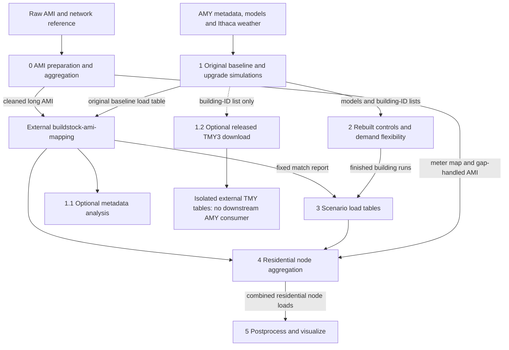

# Data flow and artifact contracts

[../README.md](../README.md) provides setup and the eight current notebook links. [repository_structure.md](repository_structure.md) defines locations, compatibility and retention; [pipeline_summary.md](pipeline_summary.md) remains the scientific report. All artifact paths below are rooted at the checkout, not at the notebook working directory. Links to private/generated files work only when those local artifacts are present.

## Working flow

**Run 0 and 1 independently → external matching → 2 → 3 → 4 → 5.** Run notebook 1 for both original baseline and upgrade 4 as needed. Notebook 2 depends on notebook 1's models and selections, not on the match report; it can run while matching is prepared. Notebook 1.1 is optional post-match analysis. Notebook 1.2 is optional released **TMY3** data and is not an input to the AMY scenario pipeline.

The archived branch comparison, optimization prototypes and UrbanOpt work are not steps in this graph. Notebook 5 consumes the combined residential scenarios; notebook 0's non-residential node columns remain available separately for downstream grid work.

## Producer / consumer contracts

CSV and Parquet basenames are unchanged by relocation. Patterns below describe filename families, not additional files that need creating. `s` means a rebuilt scenario tag; `g` means `zero`, `nan` or `interp<N>`; `t` means `s` plus optional `_midfix`.

| Artifact and canonical location | Producer → consumer | Schema / unit | Gap and scenario convention |
|---|---|---|---|
| [../data/raw/ami/ch1_4301002_individual.csv](../data/raw/ami/ch1_4301002_individual.csv) (other original consumption files also directly in this folder) | Utility → 0 | `SERVICEPOINTID`, `CHANNELNUMBER`, `ENDTIME_EST`, `INTERVAL_READ`; kWh/15 min | Raw local-clock readings; no scenario tag |
| [../data/raw/network/location_reference.csv](../data/raw/network/location_reference.csv) | Utility → 0 | `servicepointid`, `xfr_gisid`, `Residential`; IDs/classification, no energy unit | Defines map/sector; multiple transformers are possible |
| AMY metadata: [../data/raw/resstock/NY_baseline_metadata_and_annual_results_2024_amy.csv](../data/raw/resstock/NY_baseline_metadata_and_annual_results_2024_amy.csv), [../data/raw/resstock/NY_upgrade04_metadata_and_annual_results_2024_amy.csv](../data/raw/resstock/NY_upgrade04_metadata_and_annual_results_2024_amy.csv) | ResStock release → 1, 1.1 | `bldg_id`, county/building `in.*`, upgrade `applicability`, release `out.*` | Seven-county selection; `out.*` is not a 2024 re-simulation result |
| `ami_ind_data_15.*`, `ami_ind_data_hour.*` in [../data/interim/ami/](../data/interim/ami/) | 0 → external matcher (15 min), analysis | `SERVICEPOINTID`, `ENDTIME_EST`, `INTERVAL_READ`; kWh/interval or kWh/hour | 2024, duplicates averaged, Feb 29 removed; long 15-min table is **before** section 3 gap handling |
| `ami_meter_wide_15_<g>.parquet` in [../data/interim/ami/](../data/interim/ami/) | 0 → 4 | Datetime index, SPID string columns; kWh/15 min | Full 35,040-step grid with selected gap treatment; current tag `zero` |
| [../data/interim/ami/ami_meter_xfr_map.csv](../data/interim/ami/ami_meter_xfr_map.csv) | 0 → 4 | `servicepointid`, `xfr_gisid`, `sector`, `n_xfr`, `weight`, `column`, `has_ami` | One row per meter–transformer pair; `weight = 1/n_xfr`; reused unchanged |
| `building_ids_metadata_2024.csv`, `building_ids_metadata_2024_up04.csv` in [../data/interim/selection/](../data/interim/selection/) | 1 → 1.2, 2, 3 | `bldg_id` selection column; no energy unit | Original baseline vs applicable upgrade list; not interchangeable |
| Original model trees in [../models/resstock_models/](../models/resstock_models/) and [../models/resstock_models_up04/](../models/resstock_models_up04/) | 1 → 2; 1 also reads its own simulation results | Per-building released model/schedules and OpenStudio run outputs | AMY model release, Ithaca 2024 weather; no recomputation during migration |
| `resstock_timeseries_all_15[_up04].*`, `resstock_timeseries_all_hour[_up04].*`, `resstock_timeseries_annual[_up04].*` in [../data/interim/resstock/](../data/interim/resstock/) | 1 → external matcher (original baseline 15 min), validation | Timeseries: `bldg_id` int64, `time`, `ts_elec` float64; annual: `bldg_id`, `annl_elec`; kWh/15 min, kWh/hour or annual kWh | No suffix = original baseline; `_up04` = original upgrade; preserve original time conventions |
| [../data/external/matching/match_report.csv](../data/external/matching/match_report.csv) | External matcher → 1.1, 3, 4 | `meter id`, `ResStock_ids` serialized integer list | One row per meter; fixed across scenarios; see contract below |
| Three rebuilt model trees in [../models/](../models/) (see [scenario mapping](repository_structure.md#model-folders-and-scenario-tags)) | 2 → 3; DF schedules → 5 window check | Per-building simulation CSV and completion markers; facility electricity in kWh/timestep | Baseline control, up04 control, up04 DF; only completed, readable runs feed 3 |
| `resstock_timeseries_all_15_<s>.*`, `resstock_timeseries_all_hour_<s>.*`, `resstock_timeseries_annual_<s>.*` in [../data/interim/resstock/](../data/interim/resstock/) | 3 → 4 (15 min), analysis | Same columns/units as original tables, plus `meter_ids` **string** containing an integer list, including in Parquet | Separate rebuilt scenario tags; `[]` for unmatched building; CSV optional via `WRITE_CSV` |
| [../data/interim/selection/building_to_meter_map.csv](../data/interim/selection/building_to_meter_map.csv) | 3 → traceability/analysis | `building_id`, `meter_id_list` serialized list, `n_meters`; matched buildings only | Reverse many-to-many mapping, shared by scenarios |
| `aggregated_load_nodes_wide_ami_<g>.*` in [../data/processed/node_loads/](../data/processed/node_loads/) | 0 → measured reference/downstream grid work | Index `ENDTIME_EST`; `<gisid>_RES`, `<gisid>_NRS` columns; kWh/15 min | AMI gap tag; residential and non-residential |
| `aggregated_load_nodes_wide_resstock_RES_<t>.*`, `aggregated_load_nodes_wide_ami_fallback_RES_<t>_ami-<g>.*`, `aggregated_load_nodes_wide_resstock_plus_ami_fallback_RES_<t>_ami-<g>.*` in [../data/processed/node_loads/](../data/processed/node_loads/) | 4 → 5 (combined), downstream grid work | Index `time`; `<gisid>_RES` columns; kWh/15 min | ResStock part, fallback part and sum; `t` includes optional midnight fix; only fallback/combined filenames carry gap tag |
| AMI duplicates, gap summary and aggregation report; ResStock aggregation, meter status and source reports in [../reports/diagnostics/](../reports/diagnostics/) | 0, 4 → audits; baseline report → 5 check | Coverage/counts; annual `kWh_total` and component kWh; per-meter `match_status`, `source`, fallback reason | Some report names omit gap tag and/or scenario; preserve before changing settings |
| Metadata `plots*` subfolders in [../reports/metadata/](../reports/metadata/) | 1.1 → analysis | PNG distributions and CSV selected-spot summaries | Upgrade-tagged, optional post-match analysis |
| CSV summaries and PNG figures in [../reports/postprocess/](../reports/postprocess/) | 5 → interpretation/publication | Energy in MWh, demand in kW, timestamps, percent/absolute changes; system and node metrics | Current three rebuilt scenarios, `ami-zero`, no midnight fix; fixed output names |
| Optional `resstock_timeseries_*_released[_up04].*` under data/external/resstock_released/ (`PATHS.released`) | 1.2 → separate exploratory analysis only | `bldg_id`, `time`, `ts_elec`; annual `annl_elec`; kWh | Released TMY3 weather, **not** the AMY/Ithaca simulation pipeline |

The full notebook 5 output inventory and retained numerical results are in [pipeline_summary.md](pipeline_summary.md#1210-output-files). Published PNG copies remain in [figures/postprocess/](figures/postprocess/); migration does not refresh them.

## External matching handoff

1. Use the separate **buildstock-ami-mapping** repository's `grid-edge` branch and its own setup instructions. This repository does not implement or automatically run that algorithm.
2. Supply notebook 0's [../data/interim/ami/ami_ind_data_15.parquet](../data/interim/ami/ami_ind_data_15.parquet) and notebook 1's **original baseline** [../data/interim/resstock/resstock_timeseries_all_15.parquet](../data/interim/resstock/resstock_timeseries_all_15.parquet), or their same-name CSV counterparts as required by that repository. Do not substitute rebuilt, upgrade or released-TMY tables. Preserve units, ID representation, Feb-29 exclusion and the documented clock/midnight conventions.
3. Place the returned CSV at [../data/external/matching/match_report.csv](../data/external/matching/match_report.csv). The required case-sensitive headers are `meter id` and `ResStock_ids`. Use one unique row per meter, integer-compatible SPIDs, and list text such as `[510, 1655]` or `[]`, correctly quoted in CSV. IDs in the list must be numeric building IDs, not model-folder names. Notebook 3 and 4 reject duplicate meter rows and parse lists with `ast.literal_eval`; malformed list text is not a supported handoff.
4. The relationship is many-to-many: a meter may have several alternative buildings, and a building may represent several meters. Do not deduplicate buildings across meters. An empty list means no match; a missing meter row is reported separately. Notebook 4 averages the matched series per meter, then applies the meter-to-transformer weights. Unmatched residential meters use their AMI when available; meters with neither usable models nor AMI are flagged `no_data`.
5. Keep one matching result fixed across all scenarios. Archive its predecessor and record the mapping-repo revision/branch, source table identities, release/weather/time conventions and matching settings when deliberately producing a replacement. Matching quality and these provenance details are **not** established by the repository validator.

## Units, gaps and filenames

- **Time:** 2024 labels, 35,040 quarter-hours, no Feb 29. AMI has local-clock DST effects; ResStock uses standard time and a 2023 simulation calendar. Original EnergyPlus midnight relabelling is unchanged. See [pipeline_summary.md](pipeline_summary.md#11-time-alignment-and-calendar-conventions).
- **Units:** 15-minute inputs and node outputs are energy, not instantaneous power. Notebook 5 converts using $P=\frac{E}{0.25\,\mathrm{h}}$ (kWh divided by hours gives average kW). Hourly tables sum four interval values; annual tables sum energy. Do not convert node files to kW in place.
- **Gaps:** `zero` fills missing AMI with zero; `nan` keeps missing data; `interp<N>` fills only interior gaps of up to `N` quarter-hours (`INTERP_MAX_GAP`, normally 4). Longer/edge gaps remain NaN; unresolved gaps propagate through node sums. Long cleaned AMI for matching is a separate, pre-gap-handling artifact.
- **Scenarios:** notebook 1 is currently saved with `UPGRADE = 4`; generating original baseline requires a separate `UPGRADE = 0` run. Notebook 2 is saved with `SCENARIO = "baseline"`; repeat for `up04` and `up04_df_2F` to generate all controls and DF. Notebooks 3–5 use `baseline_rebuilt`, `up04_rebuilt`, `up04_df_2F`. These selections were not changed by relocation.
- **Missing upgrade buildings:** `MISSING_BLDG_POLICY = "baseline"` uses `baseline_rebuilt`; `"ami"` sends the whole meter to AMI fallback. The policy is **not encoded in filenames**. Record it with each run.
- **Midnight/gap tags:** notebook 4 forms `t = s + "_midfix"` only when `FIX_EPLUS_MIDNIGHT = True`. A combined filename ends in `<t>_ami-<g>`, before its CSV/Parquet extension. Notebook 5's tags must match exactly; the current selection uses `ami-zero` without `_midfix`.
- **Overwrite caution:** gap variants of fallback/combined node files can coexist, but ResStock-only filenames and some diagnostics omit the gap tag; notebook 5 uses fixed report names. Selections, matching provenance and settings must travel with archived outputs. A filename alone is not complete provenance.

## Validation, not regeneration

Wait until migration and file writers finish before checking local data or inventory. Default validation parses notebook code without execution and checks selected path conventions. `--data` reads a fixed set of current inputs and the three `ami-zero`, no-midnight-fix combined scenarios, checks `meter_ids` in scenario Parquet schemas, 35,040 unique timestamps/no Feb 29, finite residential values and identical scenario indices/columns. It does not cover every gap variant, all schemas, every building run, conservation against original sources, external matching accuracy or published results. `--inventory` verifies local journal sizes and recorded hashes plus Windows compatibility links; it is not an all-file checksum or simulation test. See [../README.md](../README.md#validation-without-rerunning-the-pipeline).

This documentation update performs none of those executions, simulations or output writes. Keep archived code and data outside the working flow; retain old models and provenance rather than deleting them to force regeneration.