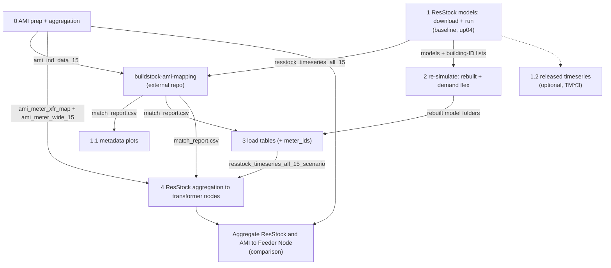

# Pipeline summary: run order, scenarios, inputs/outputs and final outcomes

Notebooks are in `grid_edge_fy25/notebooks/`; all paths below are under `grid_edge_fy25/` unless noted. Run them top to bottom, in this order:

**0 → 1 → (external mapping) → 1.1 → 2 → 3 → 4**

Notebooks 0 and 1 do not depend on each other and can run in either order. Notebook 1.2 is optional.

## Run order and dependencies

| Step | Notebook / tool | Needs | What you get |
|---|---|---|---|
| 0 | `0_ami_data_prep_and_aggregation.ipynb` | raw AMI file, `location_reference.csv` | Cleaned 2024 AMI tables; AMI aggregated per transformer node; meter-to-transformer map and meter-wide AMI table |
| 1 | `1_resstock_models_download_and_run.ipynb` | NY metadata CSV, OpenStudio | Downloaded and simulated ResStock buildings (baseline and upgrade 4), original load tables |
| ext | `buildstock-ami-mapping` (external) | outputs of 0 and 1 | `results/match_report.csv` (AMI meter to ResStock building) |
| 1.1 | `1.1_resstock_metadata_plots.ipynb` | `match_report.csv`, metadata CSV | Distribution plots of matched buildings |
| 1.2 | `1.2_resstock_timeseries_download.ipynb` (optional) | building-ID list from 1 | NREL-released TMY3 timeseries (not used downstream) |
| 2 | `2_resstock_models_df_run.ipynb` | models and building-ID lists from 1 | Rebuilt models (2025_Release_1 measures) and demand-flex models, simulated |
| 3 | `3_resstock_load_table_build.ipynb` | rebuilt models from 2, `match_report.csv` | Load tables per scenario with a `meter_ids` column; `building_to_meter_map.csv` |
| 4 | `4_resstock_aggregation.ipynb` | load tables from 3, `match_report.csv`, AMI map and meter-wide table from 0 | ResStock residential load per transformer node for each scenario, with AMI fallback for unmatched meters |
| - | `Aggregate ResStock and AMI to Feeder Node_02022026-Copy1.ipynb` | aggregated node files from 0 and 4 | Branch-level ResStock vs AMI comparison plots |

## Scenarios analysed

All scenarios use the same 766 buildings (7 counties), the `Ithaca_2024.epw` weather file and 35,040 15-minute timestamps. Upgrade 4 only applies to part of the buildings (`applicability == True`); the rest are filled according to `MISSING_BLDG_POLICY` in notebook 4.

| Scenario | Made by | Description | Used for |
|---|---|---|---|
| AMI (measured) | notebook 0 | Smart meter data of ~792 service points, gaps handled by `GAP_METHOD` (`zero`, `nan`, `interpolate`) | Reference; matching; fallback for unmatched meters |
| Original baseline (`UPGRADE = 0`) | notebook 1 | Released baseline models, simulated with 2024 weather | Matching against AMI and validation |
| Original upgrade 4 (`UPGRADE = 4`) | notebook 1 | ENERGY STAR heat pump with the existing system as backup | Matching/validation of the upgrade set |
| `baseline_rebuilt` | notebooks 2 and 3 | Baseline rebuilt with the 2025_Release_1 measures, no flexibility | Baseline for the scenario comparison |
| `up04_rebuilt` | notebooks 2 and 3 | Heat pump (upgrade 4) rebuilt, no flexibility | Control for the demand-flex run |
| `up04_df_2F` | notebooks 2 and 3 | Heat pump plus upgrade 24: HVAC demand flexibility, 2 F load shed during on-peak hours | Demand-flex scenario |

Compare scenarios only among the three rebuilt runs. The original runs are kept for validation against AMI, because the rebuild shifts annual electricity by a few percent.

## Inputs and outputs per step

`<s>` is a scenario name, `<g>` the AMI gap tag.

| Step | Inputs | Outputs |
|---|---|---|
| 0 | `data/input_files/consumption/ch1_4301002_individual.csv`, `data/input_files/location_reference.csv` | `data/parquet/ami_ind_data_15.*`, `ami_ind_data_hour.*`, `ami_duplicates_2024.csv`, `ami_meter_wide_15_<g>.parquet`; `results/aggregated_load_nodes_wide_ami_<g>.*`, `aggregated_load_nodes_ami_<g>_report.csv`, `ami_meter_xfr_map.csv`, `ami_meter_gap_summary.csv` |
| 1 | `data/input_files/NY_baseline_metadata_and_annual_results_2024_amy.csv` (and `NY_upgradeNN_...` for an upgrade), `data/base_files/` (workflow, measures, weather) | `data/base_files/building_ids_metadata_2024[_upNN].csv`, `data/resstock_models[_upNN]/`, `data/parquet/resstock_timeseries_all_15[_upNN].*`, `..._all_hour...`, `..._annual...` |
| ext | `ami_ind_data_15` (0), `resstock_timeseries_all_15` (1) | `results/match_report.csv` |
| 1.1 | `results/match_report.csv`, metadata CSV | `results/plots[_upNN]/`, `results/plots_spot_ids[_upNN]/` |
| 1.2 | `data/base_files/building_ids_metadata_2024[_upNN].csv`, public S3 bucket | `data/parquet/resstock_timeseries_*_released[_upNN].*` |
| 2 | `data/resstock_models[_up04]/`, building-ID lists (1), 2025_Release_1 measures, `Ithaca_2024.epw` | `data/resstock_models_rebuilt/`, `data/resstock_models_up04_rebuilt/`, `data/resstock_models_up04_df/` (each building with `run/eplusout.csv`) |
| 3 | rebuilt model folders (2), building-ID lists (1), `results/match_report.csv` | `data/parquet/resstock_timeseries_all_15_<s>.*`, `..._all_hour_<s>.*`, `..._annual_<s>.*` (each with `meter_ids`); `results/building_to_meter_map.csv` |
| 4 | `data/parquet/resstock_timeseries_all_15_<s>.parquet` (3), `results/match_report.csv`, `results/ami_meter_xfr_map.csv` and `data/parquet/ami_meter_wide_15_<g>.parquet` (0) | per scenario in `results/`: `aggregated_load_nodes_wide_resstock_RES_<s>.*`, `..._ami_fallback_RES_<s>_ami-<g>.*`, `..._resstock_plus_ami_fallback_RES_<s>_ami-<g>.*`, `resstock_aggregation_report_<s>.csv`, `resstock_meter_sources_<s>.csv`; plus `resstock_meter_status.csv` |

## Final outcomes

- **Transformer-node residential load per scenario** (`aggregated_load_nodes_wide_resstock_plus_ami_fallback_RES_<s>_ami-<g>.*`): the main input for the optimization work. For each of the three rebuilt scenarios it holds one 15-minute column per transformer (`<gisid>_RES`), ResStock for matched meters and AMI for the unmatched ones.
- **Measured AMI load per transformer node** (`aggregated_load_nodes_wide_ami_<g>.*`): residential and non-residential columns (`_RES`, `_NRS`), the reference and the source of the non-residential load.
- **Building load tables with `meter_ids`** (`resstock_timeseries_all_15_<s>.*`): 15-minute, hourly and annual ResStock loads per building, linked to the matched AMI meters.
- **Traceability reports:** `resstock_meter_sources_<s>.csv` and `resstock_meter_status.csv` show which meters use ResStock and which fall back to AMI.
- **Comparison and plots:** metadata distribution plots (1.1) and the ResStock vs AMI branch comparison.
