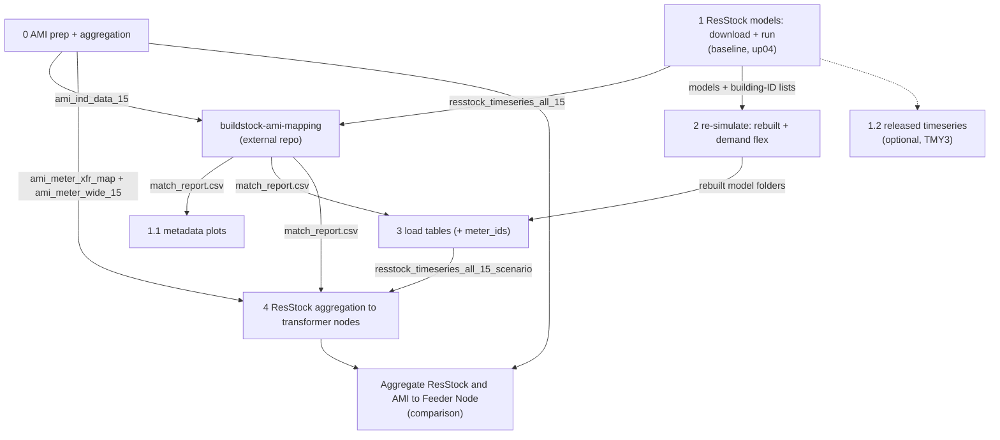

# Residential load profiles for transformer nodes from AMI and ResStock: methodology

Technical report for the GRIDs project pipeline (Dryden, NY distribution circuit). It describes **what** each step does and **why**; it does not report results. Notebooks are in `grid_edge_fy25/notebooks/`; all paths are under `grid_edge_fy25/` unless noted. Weather-release choice: see [weather_basis_amy_vs_tmy.md](weather_basis_amy_vs_tmy.md).

## Contents

1. [Purpose and scope](#1-purpose-and-scope)
2. [Pipeline overview](#2-pipeline-overview) (run order, scenarios, inputs/outputs, final outcomes)
3. [Study area and data sources](#3-study-area-and-data-sources)
4. [AMI preparation](#4-ami-preparation-notebook-0-sections-12)
5. [AMI aggregation to transformer nodes](#5-ami-aggregation-to-transformer-nodes-notebook-0-section-3)
6. [ResStock selection, download and simulation](#6-resstock-selection-download-and-simulation-notebook-1)
7. [Building–meter matching](#7-buildingmeter-matching-external-step)
8. [Rebuilt and demand-flexibility simulations](#8-rebuilt-and-demand-flexibility-simulations-notebook-2)
9. [Scenario load tables](#9-scenario-load-tables-notebook-3)
10. [ResStock aggregation to transformer nodes](#10-resstock-aggregation-to-transformer-nodes-notebook-4)
11. [Time alignment and calendar conventions](#11-time-alignment-and-calendar-conventions)
12. [Assumptions and limitations](#12-assumptions-and-limitations)
13. [Reproducibility and configuration](#13-reproducibility-and-configuration)
14. [Glossary](#14-glossary)

---

## 1. Purpose and scope

**Goal.** Produce 15-minute residential load profiles for every distribution transformer (node) of the Dryden circuit, for a measured 2024 reference and for a set of what-if scenarios: the current building stock, electrification with heat pumps, and heat pumps with HVAC demand flexibility. These profiles are the load input for the downstream grid-edge optimization.

**Approach.** Measured AMI data describes today's load but cannot answer what-if questions; building energy models can, but are not tied to specific customers. The pipeline links the two:

1. Each residential AMI meter is represented by one or more ResStock buildings whose simulated 2024 load best matches the meter's measured 2024 load (matching).
2. The matched buildings are then re-simulated under each scenario, keeping the match fixed, so differences between scenarios come only from the change to the building model.
3. Building loads are aggregated to transformer nodes through the meter→transformer map of the utility; meters without a usable match keep their measured load.

**Scope.**
- Residential load only. Non-residential meters are carried as measured AMI (`_NRS` columns) and are not changed by the scenarios.
- One year, 2024, on a 365-day 15-minute grid (35,040 intervals, Feb 29 removed).
- Not covered here: the matching algorithm itself (external repository), power-flow modelling, optimization, and results analysis.

## 2. Pipeline overview

Run the notebooks top to bottom, in this order:

**0 → 1 → (external mapping) → 1.1 → 2 → 3 → 4**

Notebooks 0 and 1 do not depend on each other and can run in either order. Notebook 1.2 is optional.

### 2.1 Run order and dependencies

| Step | Notebook / tool | Needs | What you get |
|---|---|---|---|
| 0 | `0_ami_data_prep_and_aggregation.ipynb` | raw AMI file, `location_reference.csv` | Cleaned 2024 AMI tables; AMI aggregated per transformer node; meter-to-transformer map and meter-wide AMI table |
| 1 | `1_resstock_models_download_and_run.ipynb` | NY metadata CSV, OpenStudio | Downloaded and simulated ResStock buildings (baseline and upgrade 4), original load tables |
| ext | `buildstock-ami-mapping` (external) | outputs of 0 and 1 | `results/match_report.csv` (AMI meter to ResStock building) |
| 1.1 | `1.1_resstock_metadata_plots.ipynb` | `match_report.csv`, metadata CSV | Distribution plots of matched buildings |
| 1.2 | `1.2_resstock_timeseries_download.ipynb` (optional) | building-ID list from 1 | NREL-released TMY3 timeseries (not used downstream) |
| 2 | `2_resstock_models_df_run.ipynb` | models and building-ID lists from 1 | Rebuilt models (2025_Release_1 measures) and demand-flex models, simulated |
| 3 | `3_resstock_load_table_build.ipynb` | rebuilt models from 2, `match_report.csv` | Load tables per scenario with a `meter_ids` column; `building_to_meter_map.csv` |
| 4 | `4_resstock_aggregation.ipynb` | load tables from 3, `match_report.csv`, AMI map and meter-wide table from 0 | ResStock residential load per transformer node for each scenario, with AMI fallback for unmatched meters |
| - | `Aggregate ResStock and AMI to Feeder Node_02022026-Copy1.ipynb` | aggregated node files from 0 and 4 | Branch-level ResStock vs AMI comparison plots |

### 2.2 Scenarios analysed

All scenarios use the same 766 buildings (7 counties), the `Ithaca_2024.epw` weather file and 35,040 15-minute timestamps. Upgrade 4 only applies to part of the buildings (`applicability == True`); the rest are filled according to `MISSING_BLDG_POLICY` in notebook 4.

| Scenario | Made by | Description | Used for |
|---|---|---|---|
| AMI (measured) | notebook 0 | Smart meter data of ~792 service points, gaps handled by `GAP_METHOD` (`zero`, `nan`, `interpolate`) | Reference; matching; fallback for unmatched meters |
| Original baseline (`UPGRADE = 0`) | notebook 1 | Released baseline models, simulated with 2024 weather | Matching against AMI and validation |
| Original upgrade 4 (`UPGRADE = 4`) | notebook 1 | ENERGY STAR heat pump with the existing system as backup | Matching/validation of the upgrade set |
| `baseline_rebuilt` | notebooks 2 and 3 | Baseline rebuilt with the 2025_Release_1 measures, no flexibility | Baseline for the scenario comparison |
| `up04_rebuilt` | notebooks 2 and 3 | Heat pump (upgrade 4) rebuilt, no flexibility | Control for the demand-flex run |
| `up04_df_2F` | notebooks 2 and 3 | Heat pump plus upgrade 24: HVAC demand flexibility, 2 F load shed during on-peak hours | Demand-flex scenario |

Compare scenarios only among the three rebuilt runs. The original runs are kept for validation against AMI, because the rebuild shifts annual electricity by a few percent.

### 2.3 Inputs and outputs per step

`<s>` is a scenario name, `<g>` the AMI gap tag.

| Step | Inputs | Outputs |
|---|---|---|
| 0 | `data/input_files/consumption/ch1_4301002_individual.csv`, `data/input_files/location_reference.csv` | `data/parquet/ami_ind_data_15.*`, `ami_ind_data_hour.*`, `ami_duplicates_2024.csv`, `ami_meter_wide_15_<g>.parquet`; `results/aggregated_load_nodes_wide_ami_<g>.*`, `aggregated_load_nodes_ami_<g>_report.csv`, `ami_meter_xfr_map.csv`, `ami_meter_gap_summary.csv` |
| 1 | `data/input_files/NY_baseline_metadata_and_annual_results_2024_amy.csv` (and `NY_upgradeNN_...` for an upgrade), `data/base_files/` (workflow, measures, weather) | `data/base_files/building_ids_metadata_2024[_upNN].csv`, `data/resstock_models[_upNN]/`, `data/parquet/resstock_timeseries_all_15[_upNN].*`, `..._all_hour...`, `..._annual...` |
| ext | `ami_ind_data_15` (0), `resstock_timeseries_all_15` (1) | `results/match_report.csv` |
| 1.1 | `results/match_report.csv`, metadata CSV | `results/plots[_upNN]/`, `results/plots_spot_ids[_upNN]/` |
| 1.2 | `data/base_files/building_ids_metadata_2024[_upNN].csv`, public S3 bucket | `data/parquet/resstock_timeseries_*_released[_upNN].*` |
| 2 | `data/resstock_models[_up04]/`, building-ID lists (1), 2025_Release_1 measures, `Ithaca_2024.epw` | `data/resstock_models_rebuilt/`, `data/resstock_models_up04_rebuilt/`, `data/resstock_models_up04_df/` (each building with `run/eplusout.csv`) |
| 3 | rebuilt model folders (2), building-ID lists (1), `results/match_report.csv` | `data/parquet/resstock_timeseries_all_15_<s>.*`, `..._all_hour_<s>.*`, `..._annual_<s>.*` (each with `meter_ids`); `results/building_to_meter_map.csv` |
| 4 | `data/parquet/resstock_timeseries_all_15_<s>.parquet` (3), `results/match_report.csv`, `results/ami_meter_xfr_map.csv` and `data/parquet/ami_meter_wide_15_<g>.parquet` (0) | per scenario in `results/`: `aggregated_load_nodes_wide_resstock_RES_<s>.*`, `..._ami_fallback_RES_<s>_ami-<g>.*`, `..._resstock_plus_ami_fallback_RES_<s>_ami-<g>.*`, `resstock_aggregation_report_<s>.csv`, `resstock_meter_sources_<s>.csv`; plus `resstock_meter_status.csv` |

### 2.4 Final outcomes

- **Transformer-node residential load per scenario** (`aggregated_load_nodes_wide_resstock_plus_ami_fallback_RES_<s>_ami-<g>.*`): the main input for the optimization work. For each of the three rebuilt scenarios it holds one 15-minute column per transformer (`<gisid>_RES`), ResStock for matched meters and AMI for the unmatched ones.
- **Measured AMI load per transformer node** (`aggregated_load_nodes_wide_ami_<g>.*`): residential and non-residential columns (`_RES`, `_NRS`), the reference and the source of the non-residential load.
- **Building load tables with `meter_ids`** (`resstock_timeseries_all_15_<s>.*`): 15-minute, hourly and annual ResStock loads per building, linked to the matched AMI meters.
- **Traceability reports:** `resstock_meter_sources_<s>.csv` and `resstock_meter_status.csv` show which meters use ResStock and which fall back to AMI.
- **Comparison and plots:** metadata distribution plots (1.1) and the ResStock vs AMI branch comparison.

---

## 3. Study area and data sources

| Source | Content | Used for |
|---|---|---|
| AMI interval data (`ch1_4301002_individual.csv`) | `SERVICEPOINTID`, `CHANNELNUMBER`, `ENDTIME_EST` (interval end), `INTERVAL_READ` (kWh per 15 min); about 792 service points (SPIDs) on the Dryden circuit, 154 of them non-residential | Measured reference, matching target, fallback load |
| Location reference (`location_reference.csv`) | SPID → transformer (`xfr_gisid`) and sector (`Residential`) | Meter-to-node map |
| ResStock metadata, AMY release (`resstock_amy2018_release_2`, OEDI bucket `oedi-data-lake`) | Building characteristics, upgrade applicability, annual results for NY | Building selection |
| ResStock building models (same release) | Per-building `home.xml`, `in.schedules.csv`, `in.osm` for the baseline and upgrade 4 | Simulation |
| Weather file `Ithaca_2024.epw` | Actual 2024 weather for Ithaca | All simulations |
| OpenDSS feeder model | Transformer-level topology | Node definitions downstream (not used for the load build) |

**Building sample.** All 766 NY ResStock buildings in the seven counties around Ithaca (Cayuga, Chemung, Cortland, Schuyler, Seneca, Tioga, Tompkins) are simulated, not only the ones that end up matched. Justification: the matching step needs a candidate pool, and the pool should reflect the regional stock (climate zone, vintages, heating fuels) rather than the state as a whole. The county filter keeps the pool small enough to simulate locally while remaining representative of the circuit.

**Release choice (AMY vs TMY).** The AMY 2018 release is used for both metadata and models so that the building sample and its characteristics come from one consistent release. The release's own weather is not used: every model is re-simulated with the actual 2024 weather so that simulated and measured loads share the same weather year. Annual `out.*` columns of the metadata (simulated with 2018 weather) are therefore not comparable with the 2024 simulations. Details and the expected TMY/AMY differences are in [weather_basis_amy_vs_tmy.md](weather_basis_amy_vs_tmy.md).

## 4. AMI preparation (notebook 0, sections 1–2)

| Step | Method | Justification |
|---|---|---|
| Year filter | Keep `ENDTIME_EST` in 2024 | Same year as the weather file |
| Duplicates | Average rows with the same (SPID, timestamp) | All duplicates are the daylight-saving fall-back hour (Nov 3, 01:00–01:45), recorded twice in local clock time. Averaging keeps one value per interval on a regular grid; summing would double the hour, dropping one copy would be arbitrary |
| Leap day | Drop Feb 29 | The ResStock schedules have 365 days (35,040 rows); keeping Feb 29 would shift every later day by one against the simulations |
| Hourly table | Sum the four 15-min values by `floor(hour)` of the interval-end timestamp | Same convention as the ResStock hourly tables, so the two are directly comparable (see §11) |
| Diagnostic | Report multi-channel meters and duplicate rows (`ami_duplicates_2024.csv`) | Makes the duplicate handling auditable |

Values stay in kWh per 15 min (energy, not power) throughout, so aggregation is a plain sum and energy is conserved by construction.

## 5. AMI aggregation to transformer nodes (notebook 0, section 3)

**Regular grid.** Meters are pivoted to a time × SPID table on the full 35,040-step grid. Missing readings (including the spring-forward hour, missing for every meter) become explicit NaN so that they can be counted and handled consistently.

**Gap handling (`GAP_METHOD`).** A per-meter gap summary (coverage, number and length of gaps, first/last reading) is written before any filling. Three options are offered because no single choice suits every downstream use:

| Method | Behaviour | When to use | Trade-off |
|---|---|---|---|
| `zero` | NaN → 0 | Energy totals; reproduces the original notebook | Biases load low during gaps; creates artificial dips |
| `nan` | NaN kept and propagated | Strict analyses that must not use invented data | A node column is NaN wherever any of its meters is missing |
| `interpolate` | Linear interpolation of interior gaps of at most `INTERP_MAX_GAP` intervals (default 4 = 1 h); longer and edge gaps stay NaN | Time-series use (optimization) where short telemetry drops should not create dips | Smooths short peaks; long outages remain unresolved |

The gap tag (`zero`, `nan`, `interp<N>`) is written into every output name so that results built with different choices cannot be mixed by accident.

**Meter → transformer map.** Each SPID–transformer pair of the location reference becomes one row. Sector is `RES` when the `Residential` field starts with "res", otherwise `NRS`. A meter listed on *n* transformers (62 meters) is split equally, `weight = 1/n_xfr`. Justification: the location file gives no allocation share, and an equal split conserves the meter's energy while avoiding double counting. Meters without a transformer, and location-file meters without AMI, are reported rather than silently dropped.

**Aggregation.** Each node column `<xfr_gisid>_<RES|NRS>` is $\sum_m w_m \, E_m(t)$ over the meters with AMI on that transformer and sector, with `skipna=False` so that unresolved gaps stay visible. For `zero`, an assertion checks that total meter energy equals total node energy (relative tolerance $10^{-9}$).

**Outputs for later steps.** The map (`ami_meter_xfr_map.csv`) and the gap-handled meter-wide table (`ami_meter_wide_15_<g>.parquet`) are saved so that notebook 4 reuses exactly the same map, weights and gap treatment for its AMI fallback.

## 6. ResStock selection, download and simulation (notebook 1)

**Selection.** For the baseline, all 766 county buildings. For an upgrade (`UPGRADE = 4`), only buildings with `applicability == True` in the upgrade metadata (483 of 766 for upgrade 4), because model zips exist only for those. Every output of an upgrade run carries an `_upNN` tag so that runs never overwrite each other.

**Download.** Models are fetched from the public OEDI bucket in parallel (boto3 multipart, AWS CLI fallback); finished downloads are skipped on re-runs.

**Simulation.** Each model runs with OpenStudio 3.8.0 / EnergyPlus 24.1 through `workflow_resstock.osw`, seeded with the released `in.osm` and pointed at `Ithaca_2024.epw`. Justification: the released `in.osm` reproduces the released model exactly, so the only change from the release is the weather. The run period is set to 2023-01-01 to 2023-12-31 at 4 timesteps per hour (`set_run_period`), giving 35,040 intervals that match the 365-day schedules.

**Outputs measure.** `add_outputs` registers an EMS sensor on `Electricity:Facility` and reports it in kWh per timestep. Only this meter is registered by default: EnergyPlus creates some meters (e.g. `Cooling:Electricity`, `WaterSystems:NaturalGas`) only when a matching component exists, and a sensor on a missing meter aborts the run. Additional meters are opt-in (`include_extra_meters`).

**Failure handling.** A building fails if OpenStudio returns non-zero or `run/failed.job` exists; the first Severe error of each failure is summarised by cause. Re-runs skip finished buildings, so a batch can be resumed after fixing the cause.

**Load tables.** `eplusout.csv` of every finished building is condensed into 15-min, hourly and annual tables (`resstock_timeseries_all_15[_upNN]`, …), with the time conventions of §11. These "original" tables feed the matching step.

## 7. Building–meter matching (external step)

Matching is done in the separate `buildstock-ami-mapping` repository (`grid-edge` branch) from the 15-min AMI table (notebook 0) and the original ResStock baseline table (notebook 1). It ranks candidate buildings for each residential meter by load-shape agreement (CVRMSE, peak timing similarity and related shape metrics) and writes `results/match_report.csv` (`meter id` → `ResStock_ids`).

Properties that the later steps rely on:

- A meter can be matched to several buildings (*k* ≥ 1) or to none (empty list).
- A building can be matched to several meters (up to 14). This is expected: the candidate pool is small relative to the number of meters, and similar homes legitimately share an archetype.
- Matching is done once, against the original baseline runs, and is then held fixed for all scenarios. This isolates the scenario effect from any change in which buildings represent which meters.

## 8. Rebuilt and demand-flexibility simulations (notebook 2)

**Why rebuild.** The demand-flexibility measure (ResStock upgrade 24, "HVAC Demand Flexibility with On-Peak Load Shedding") exists only in ResStock `2025_Release_1` and acts on the HPXML schedules before the model is built. The released `in.osm` cannot be modified this way, so the models must be rebuilt from `home.xml` + `in.schedules.csv` with the 2025 measures. To keep scenario differences attributable to the flexibility alone, the no-flex controls (baseline and upgrade 4) are rebuilt through the identical path with a 0 °F offset.

**Common build path (per building).**

1. Copy `home.xml`, `in.schedules.csv` (if present) and the weather file from the source model; the source folders are never modified.
2. Apply compatibility patches (below).
3. Run `ResStockArgumentsPostHPXML` (setpoint shift; skipped at 0 °F) → `HPXMLtoOpenStudio` → `set_run_period` → `add_outputs` → EnergyPlus.

**Compatibility patches and their reasons.**

| Patch | Reason |
|---|---|
| ResStock `2025_Release_1` export with `OS_Version` set to 3.8.0 and `setKeepSiteLocationInformation` guarded | Run on the same OpenStudio 3.8.0 / EnergyPlus 24.1 as the original runs, so the engine is not a confounder |
| Derived weather file `Ithaca_2024_noleap2023.epw` (Feb 29 removed, year 2023) | The 365-day schedules do not fit the 8,784-hour leap-year EPW and the newer `HPXMLtoOpenStudio` rejects the mismatch; the 2023 calendar matches the run period of the original runs |
| Drop the all-zero `Vacancy` / `Power Outage` schedule columns | The newer reader treats them as unknown columns and fails; being all zero, they carry no information |
| Remove `DesignLoads`, `EmissionsScenarios` and the default `TemperatureCapacitanceMultiplier` from `home.xml` | Old element layout rejected by the newer schema, or references to files only present in a full ResStock checkout; design loads are recomputed during the build |
| Copy of `add_outputs` with EMS update frequency `ZoneTimestep` | EnergyPlus 24.1 rejects `Timestep` for that EMS output variable |

**Upgrade 24 settings.** `hvac_flex_peak_offset = 2` °F, pre-peak duration and offset 0, random shift 0. This is a pure on-peak load shed: heating setpoint −2 °F and cooling setpoint +2 °F during the NY on-peak window (18–22 h in summer, 17–21 h in winter and intermediate months, one hour later during DST). Pre-conditioning and randomisation are disabled so the scenario represents a single, transparent control action; other variants can be added as new entries of `SCENARIOS`.

**Vacant homes.** Buildings with no residents (69 in upgrade 4, 111 in the baseline) have no `in.schedules.csv` in the release. They are built with the default HPXML schedules, and the flexibility measure creates a schedule file with only the setpoint columns. They are kept so that every scenario contains the same buildings.

**Comparability.** The rebuild changes annual electricity by a few percent and not in a consistent direction (tested on one building: baseline −2.5 %, upgrade 4 +1.7 %), owing to measure-version differences. Scenarios are therefore compared only among the rebuilt runs; the original runs remain the basis for matching and validation against AMI.

## 9. Scenario load tables (notebook 3)

**Inclusion rule.** A building is used only if `run/eplusout.csv` and `run/finished.job` exist and `run/failed.job` does not. Unfinished and unreadable buildings are listed per scenario, so incomplete batches are visible instead of silently shrinking the sample.

**Conventions.** Identical to notebook 1 (column `EMS:EMS_ElectricityFacility_kWh `, `2024-` label prefix, midnight relabel, `floor(hour)` sums; §11), so original and rebuilt tables can be read with the same code.

**`meter_ids`.** Every row carries the list of AMI meters the building is matched to (from `match_report.csv`; `[]` when unmatched), and `building_to_meter_map.csv` lists the pairs. Justification: the building–meter relation is many-to-many; carrying it with the load data lets downstream users filter or join without re-reading the match report.

**Streaming.** Buildings are read in parallel and written incrementally to Parquet/CSV, so the full 15-min table (tens of millions of rows) never has to fit in memory. CSV output is optional (`WRITE_CSV`).

## 10. ResStock aggregation to transformer nodes (notebook 4)

**Meter load from matched buildings.** A residential meter matched to *k* buildings receives the average of their series:

$$
E_m^{\text{ResStock}}(t) = \frac{1}{k_m} \sum_{b \in B_m} E_b(t)
$$

Averaging (rather than summing) keeps one dwelling per meter, which is what a residential meter measures; the *k* matches are alternative representations of the same home. A building matched to several meters is counted once **per meter**: each meter is a separate dwelling, so reuse of an archetype is legitimate. (The superseded notebook de-duplicated buildings per transformer and under-counted load.)

**Node load.** Meter loads are distributed with the same `1/n_xfr` weights as notebook 0, so ResStock and AMI node columns share one map:

$$
E_x^{\text{RES}}(t) = \sum_{m \in M_x^{\text{matched}}} w_{m,x} \, E_m^{\text{ResStock}}(t) + \sum_{m \in M_x^{\text{fallback}}} w_{m,x} \, E_m^{\text{AMI}}(t)
$$

**AMI fallback.** Residential meters with an empty match list or absent from the match report keep their measured AMI load (from `ami_meter_wide_15_<g>`, i.e. with the chosen gap treatment). Justification: dropping them would under-state node load, while assigning an arbitrary building would invent a load shape. The fallback part is unchanged across scenarios, which is a stated limitation (§12). Meters with neither a match nor AMI contribute nothing and are flagged `no_data`. The ResStock part, the fallback part and their sum are written as separate files so that each can be used or checked on its own.

**Buildings missing from a scenario.** Upgrade 4 applies to only part of the stock, so some matched buildings have no upgrade series. `MISSING_BLDG_POLICY`:

- `"baseline"` (default): use the building's `baseline_rebuilt` series, i.e. a non-applicable building keeps its existing equipment. This mirrors how ResStock itself treats non-applicable buildings.
- `"ami"`: send the whole meter to the AMI fallback.

**Checks and traceability.** Per scenario, the total energy of the ResStock node table is asserted equal to the weighted sum of the meter loads (relative tolerance $10^{-9}$). `resstock_meter_status.csv` (`match_status` = `matched`, `empty_match` or `not_in_report`, plus `has_ami`) and `resstock_meter_sources_<s>.csv` (source per meter: `resstock`, `ami_fallback` or `no_data`, with the reason) make every node value traceable to its meters and buildings; `resstock_aggregation_report_<s>.csv` summarises each transformer.

**Non-residential load** is not modelled; the `_NRS` columns of notebook 0 are used unchanged.

## 11. Time alignment and calendar conventions

| Item | Convention | Consequence |
|---|---|---|
| Grid | 2024-01-01 00:00 to 2024-12-31 23:45, interval-end, Feb 29 removed: 35,040 steps | Same index for AMI and every ResStock scenario |
| Units | kWh per 15 min | Sums are energy; divide by 0.25 h for average kW |
| Simulation calendar | Run period 2023 (Jan 1 = Sunday); 2024 weather mapped by month/day; labels re-prefixed `2024-` | Weather and labels are aligned by date. The EnergyPlus weekday is 1 day behind the 2024 weekday before Feb 29 and 2 days behind after it, so weekday/weekend patterns align only approximately |
| EnergyPlus midnight | `24:00:00` relabelled to `00:00:00` of the **same** day when building the tables | 1 of 96 intervals per day is labelled 24 h early; `FIX_EPLUS_MIDNIGHT = True` in notebook 4 moves it to the next day (`_midfix` in output names). The first interval of the year is 0 in ResStock |
| Clock | ResStock in local standard time; AMI in local clock time with DST | From Mar 10 to Nov 3, ResStock and AMI differ by one hour. The AMI fall-back hour is averaged and the spring-forward hour is missing |
| Hourly tables | Sum by `floor(hour)` of the interval-end stamp | Hour *h* holds intervals ending at *h*:00–*h*:45, identical for AMI and ResStock |

These conventions are documented rather than corrected in the data because the original tables feed the external matching step, and changing them would change the match. The optional midnight fix is applied at aggregation time only.

## 12. Assumptions and limitations

- **Representation.** Each matched meter is represented by archetypal ResStock buildings, not by a model of the actual home. Node loads are plausible, statistically grounded profiles, not reconstructions of individual customers.
- **Fixed match.** Matching uses the original baseline runs and is held fixed across scenarios; how well a match represents a meter under electrification is not tested.
- **Fallback meters are static.** AMI-fallback meters and the non-residential load do not respond to scenarios, so scenario differences at a node are diluted in proportion to its unmatched share.
- **Applicability.** With `MISSING_BLDG_POLICY = "baseline"`, non-applicable buildings keep their existing system in the upgrade scenarios; the upgrade scenarios are therefore partial electrification.
- **Rebuild offset.** Rebuilt and original runs differ by a few percent annually; only rebuilt runs are compared with each other.
- **Equal split.** Meters on several transformers are split equally in the absence of better information.
- **Gap handling.** `zero` biases load low during gaps; `nan` leaves holes; `interpolate` fills only short interior gaps.
- **Calendar and clock.** Weekday offset (1–2 days), DST hour offset and the midnight relabel (§11) limit the precision of sub-daily comparisons between ResStock and AMI.
- **Weather.** One year (2024) of actual weather; no inter-annual variability. AMY metadata annual results are not comparable with the 2024 simulations.
- **Demand flexibility.** A single fixed control (2 °F shed, no pre-conditioning, no randomisation, full participation of the matched homes). Simultaneous response of all homes is an upper-bound assumption for the rebound and peak effects.
- **Sector flag.** Residential/non-residential classification relies on the utility location file.

## 13. Reproducibility and configuration

**Software.** Python environment from `requirements.txt` (pandas, numpy, pyarrow); OpenStudio 3.8.0 with EnergyPlus 24.1 on Windows; ResStock `2025_Release_1` export (notebook 2 only); the `buildstock-ami-mapping` repository for matching. Run notebooks from `grid_edge_fy25/notebooks/`.

**Configuration knobs.**

| Notebook | Parameter | Meaning | Default |
|---|---|---|---|
| 0 | `AMI_FILE` | Raw AMI file | `data/input_files/consumption/ch1_4301002_individual.csv` |
| 0 | `GAP_METHOD`, `INTERP_MAX_GAP` | AMI gap treatment (§5) | `"zero"`, 4 |
| 1 | `UPGRADE` | 0 = baseline, otherwise upgrade id (`_upNN` outputs) | 0 |
| 1 | `MAX_WORKERS`, `MAX_PARALLEL`, `SKIP_FINISHED`, `SYNC_MEASURES` | Download/simulation parallelism and resume behaviour | see notebook |
| 2 | `SCENARIO` / `SCENARIOS` | Build path and flex settings per scenario | `baseline`, `up04`, `up04_df_2F` |
| 3 | `SCENARIOS_TO_BUILD`, `WRITE_CSV`, `N_WORKERS` | Which tables to build; CSV output; parallel reads | all, `True`, 8 |
| 4 | `SCENARIOS`, `BASELINE_SCENARIO` | Scenarios to aggregate; substitute for missing buildings | the three rebuilt runs, `baseline_rebuilt` |
| 4 | `MISSING_BLDG_POLICY` | `"baseline"` or `"ami"` (§10) | `"baseline"` |
| 4 | `AMI_GAP_TAG` | Which notebook 0 gap output to use for the fallback | `"zero"` |
| 4 | `FIX_EPLUS_MIDNIGHT` | Move the ResStock 00:00 rows to the next day (§11) | `False` |

**Output naming.** `<s>` = scenario, `<g>` = AMI gap tag, `_upNN` = upgrade of an original run, `_midfix` = midnight fix applied. Each combination writes its own files, so variants can coexist and every result file states how it was made.

**Idempotence.** Downloads, simulations and the building-ID lists are skipped when already present (delete them to regenerate); load tables and aggregation outputs of the same scenario are overwritten.

## 14. Glossary

| Term | Meaning |
|---|---|
| AMI | Advanced metering infrastructure; 15-min smart-meter readings |
| SPID | Service point ID, one AMI meter |
| GISID / `xfr_gisid` | Transformer ID in the utility GIS; one transformer node |
| `_RES` / `_NRS` | Residential / non-residential column of a node |
| ResStock | NREL/NLR building-stock model of US homes; each building is a sample with an EnergyPlus model |
| AMY / TMY | Actual / typical meteorological year weather |
| Upgrade 4 | ResStock ENERGY STAR heat pump, existing system as backup |
| Upgrade 24 | ResStock HVAC demand flexibility with on-peak load shedding |
| Original run | Released `in.osm` simulated with 2024 weather (notebook 1) |
| Rebuilt run | Model rebuilt from `home.xml` with `2025_Release_1` measures (notebook 2) |
| Match | Assignment of ResStock buildings to an AMI meter (`match_report.csv`) |
| AMI fallback | Use of a meter's measured AMI load when it has no usable match |
| Gap tag | `zero`, `nan` or `interp<N>`: the AMI gap treatment used |
| Interval-end | A timestamp labels the 15 minutes ending at that time |
| CVRMSE | Coefficient of variation of the root-mean-square error |
